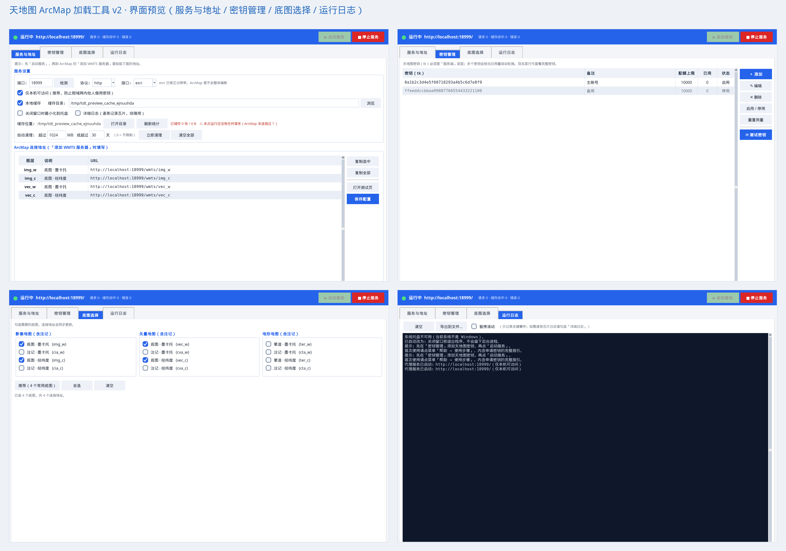

# 天地图 ArcMap 加载工具（tianditu-arcmap）

[](https://github.com/MaroD1M/tianditu-arcmap/actions/workflows/build.yml)
[](https://github.com/MaroD1M/tianditu-arcmap/releases)
[](LICENSE)

一个把**天地图**（国家地理信息公共服务平台）在线底图加载到 **ArcMap** 的图形化工具。

在本机启动一个轻量瓦片代理服务，用可视化界面管理天地图密钥（tk）、多密钥自动轮换、
本地缓存与自动清理，一键生成 ArcMap 连接地址。**运行期零第三方依赖**，可打包成单个 exe 分发。
已在 **ArcMap 10.2.2 / 10.8.2** 实测可用。



> 文档：[使用说明](docs/使用说明.md) ·
> [打包说明](docs/打包说明.md) ·
> [技术手册](docs/技术手册.md)

---

## 目录

- [特性](#特性)
- [快速开始](#快速开始)
- [申请天地图密钥](#申请天地图密钥)
- [在 ArcMap 中使用](#在-arcmap-中使用)
- [支持的底图](#支持的底图)
- [配置说明](#配置说明)
- [缓存机制](#缓存机制)
- [打包成 exe](#打包成-exe)
- [Windows/SmartScreen 提示怎么办](#windowssmartscreen-提示怎么办)
- [代码签名](#代码签名)
- [常见问题](#常见问题)
- [隐私与安全](#隐私与安全)
- [技术说明](#技术说明)
- [项目结构](#项目结构)
- [文档](#文档)
- [许可证](#许可证)

---

## 特性

| 特性 | 说明 |
|------|------|
| **可视化密钥管理** | 添加 / 编辑 / 删除多个天地图密钥，无需手改配置文件 |
| **多密钥自动轮换** | 按当日用量自动选择用量最低、未超额的密钥，规避每日限额 |
| **一键测试密钥** | 用真实瓦片验证密钥是否有效、额度是否用尽 |
| **本地瓦片代理** | 一键启停本地 HTTP 服务，把天地图瓦片转发给 ArcMap |
| **本地缓存** | 瓦片按真实类型存为 `.jpg` / `.png`，跨会话复用，节省密钥配额 |
| **缓存自动清理** | 支持按**体积上限**（默认 1 GB）和**过期天数**（默认 30 天）自动清理 |
| **ArcMap 连接地址** | 自动生成并支持一键复制，贴进 ArcMap 即可用 |
| **系统托盘运行** | 关闭窗口最小化到托盘，瓦片服务后台继续运行 |
| **零第三方依赖** | 仅用 Python 标准库，托盘用 Windows 原生 API（ctypes）实现 |
| **现代扁平界面** | 主色蓝顶栏 + 卡片式布局；表格带**列分隔线 / 隔行底色**，勾选框为清晰的「√」 |
| **高 DPI 适配** | 高分屏下界面不模糊 |
| **不采集任何信息** | 无遥测、无上报，密钥只保存在本机 |

---

## 快速开始

### 环境要求

- **Windows 10 / 11**（托盘功能依赖 Windows API；核心代理逻辑跨平台）
- **Python 3.8+**（使用打包好的 exe 则无需 Python）
- **ArcMap 10.2 及以上**（已在 **10.2.2** 与 **10.8.2** 实测可用；通过标准 WMTS 接口接入）

### 方式一：下载现成的 exe（最简单）

前往 [**Releases**](https://github.com/MaroD1M/tianditu-arcmap/releases) 下载（二选一）：

- `Tianditu-ArcMap-Loader.exe` —— 单文件，双击即用（无需安装 Python）；
- `Tianditu-ArcMap-Loader-portable.zip` —— 便携包（exe + 使用提示），
  用 7-Zip 解压后运行可避开部分 SmartScreen 拦截。

程序窗口标题为「天地图 ArcMap 加载工具」。若被 SmartScreen 拦截，见
[下方说明](#windowssmartscreen-提示怎么办)。

### 方式二：直接运行源码

```bash
# 1. 获取代码
git clone https://github.com/MaroD1M/tianditu-arcmap.git
cd tianditu-arcmap

# 2. 直接运行（无需安装任何依赖）
python tianditu_gui.py
```

> `tkinter` 是 Python 标准库，Windows 官方安装包已自带，无需额外安装。

### 方式三：自己打包成 exe

```bat
:: 双击运行（自动安装 PyInstaller 并打包）
build.bat
```

生成的文件位于 `dist\天地图加载工具.exe`，**单独拷贝这一个文件**即可给他人使用。

详见 [打包说明](docs/打包说明.md)。

### 三步用起来

1. **申请密钥** → 在「密钥管理」页签点「＋ 添加」，粘贴天地图 tk
2. **启动服务** → 点右上角「▶ 启动服务」，状态变绿
3. **复制地址** → 在「服务与地址」页签选中一行点「复制选中」

---

## 申请天地图密钥

1. 打开天地图官网 <https://www.tianditu.gov.cn/> ，注册并登录
2. 首页下拉找到「开发资源」→「成为开发者 / 控制台」
3. 点「创建新应用」：
   - 应用名称：随意，例如 `ArcMap底图`
   - **应用类型：必须选「服务端」**
     （选「浏览器端」在 ArcMap 里无法使用）
4. 创建成功后复制那串 Key，即为本工具需要的密钥（tk）
5. 免费账号每天约 1 万次请求，一般出图够用

> 可以在本工具中添加多个密钥，程序会按用量自动轮换以规避限额。

---

## 在 ArcMap 中使用

1. 打开 ArcMap → 菜单「目录 / Catalog」→「GIS 服务器」
2. 右键「**添加 WMTS 服务器**」
3. URL 粘贴本工具中复制的地址，例如：
   ```
   http://localhost:8080/wmts/img_w
   ```
4. 点「获取图层」，能展开看到分级图层即为成功
5. 确定后把图层拖到内容列表即可看到底图

> **提示**：本工具默认使用天地图的 ArcGIS 兼容接口（`/esri/wmts`），
> 该接口的图层分辨率已按 EPSG:3857 修正，在 ArcMap 中**不会出现整体偏移**。

---

## 支持的底图

| 图层 | 说明 | 坐标 |
|------|------|------|
| `img_w` / `img_c` | 影像底图 | 墨卡托 / 经纬度 |
| `cia_w` / `cia_c` | 影像注记 | 墨卡托 / 经纬度 |
| `vec_w` / `vec_c` | 矢量底图 | 墨卡托 / 经纬度 |
| `cva_w` / `cva_c` | 矢量注记 | 墨卡托 / 经纬度 |
| `ter_w` / `ter_c` | 地形晕渲 | 墨卡托 / 经纬度 |
| `cta_w` / `cta_c` | 地形注记 | 墨卡托 / 经纬度 |

> `_w` = Web 墨卡托（WGS1984），`_c` = 经纬度（CGCS2000）。
> 界面中按「影像地图 / 矢量地图 / 地形地图」三组展示，每组内含底图与对应注记。

---

## 配置说明

配置保存在程序所在目录的 `config.json`（首次运行自动生成）：

| 字段 | 默认值 | 说明 |
|------|--------|------|
| `port` | `80` | 本地服务端口。无管理员权限或被占用时建议改成 `8080` 等 |
| `scheme` | `"http"` | 请求天地图使用的协议 |
| `mode` | `"esri"` | `esri` = ArcGIS 兼容接口（推荐）；`ogc` = 标准 OGC 接口 |
| `local_only` | `true` | **仅本机可访问**。设为 `false` 才允许局域网访问 |
| `cache_enabled` | `true` | 是否启用本地缓存 |
| `cache_dir` | `"cache"` | 缓存目录。相对路径解析为**程序所在目录**下 |
| `cache_max_mb` | `1024` | 缓存体积上限（MB），`0` = 不限制 |
| `cache_expire_days` | `30` | 缓存过期天数，`0` = 不过期 |
| `layers` | 4 个常用底图 | 生成连接地址的底图列表 |
| `tokens` | `[]` | 密钥列表（含 `token` / `active` / `limit` / `description`） |
| `close_to_tray` | `true` | 关闭窗口时最小化到托盘 |
| `autostart` | `false` | 开机自动启动（写入注册表 Run 项） |
| `geometry` | `""` | 上次窗口大小位置 |
| `verbose_log` | `false` | 逐条记录瓦片日志（排障用，日常建议关闭） |

> 界面上的「文件 → 导出 / 导入配置」可用于换机或分发给同事。
> **`config.json` 含密钥，请勿提交到版本库**（已在 `.gitignore` 中排除）。

---

## 缓存机制

### 存储位置与格式

```
<cache_dir>/
└── img_w/
    └── 18/
        └── 93797/
            ├── 220357.jpg          ← 瓦片原图（按真实类型命名）
            └── 220357.jpg.ctype    ← 记录 Content-Type（兜底用）
```

- 存储的是天地图返回的**原始字节**，无任何转码
- 扩展名按真实图片类型自动决定（`.jpg` / `.png`）
- **兼容旧版 `.tile` 缓存**，无需重新下载

### 自动清理

| 设置 | 默认 | 说明 |
|------|------|------|
| 体积上限 | 1 GB | 超限时从**最旧**的瓦片开始删，直到降到上限内 |
| 过期天数 | 30 天 | 修改时间早于该天数的瓦片会被删除 |
| 触发时机 | — | **程序启动时**自动执行一次；也可随时点「立即清理」 |

「清空全部」**只删除本程序生成的瓦片**，不会误删你放在该目录下的其它文件，
并且会拒绝将缓存目录设为程序目录、磁盘根目录或系统目录。

### 与 ArcMap 自身缓存的区别

| | 本工具缓存 | ArcMap 自身缓存 |
|---|---|---|
| 位置 | 你设置的目录 | ArcMap 内部临时目录 |
| 可配置 | 是 | 否，内部行为 |
| 保留 | 按上述规则，默认长期保留 | 临时，关闭文档/程序后通常释放 |

即使不启用本工具缓存，ArcMap 仍能显示地图；本工具缓存的价值在于**跨会话保留**，
第二次打开同一区域无需重新请求天地图，既快又省密钥配额。

---

## 打包成 exe

```bat
:: 最简单的做法
build.bat
```

或手动执行：

```bat
pip install pyinstaller
pyinstaller --noconfirm --clean --onefile --windowed --noupx --name "天地图加载工具" tianditu_gui.py
```

| 参数 | 作用 |
|------|------|
| `--onefile` | 打包成单个 exe |
| `--windowed` | 不显示控制台窗口（纯图形界面） |
| `--icon app.ico` | 可选，程序与托盘图标 |

> **注意**：`--name` 与其值之间**必须有空格**（`--name "xxx"`）。
> 写成 `--name"xxx"` 会被 Python 的 argparse 判为无法识别的参数。

更多细节见 [打包说明](docs/打包说明.md)。

---

## Windows/SmartScreen 提示怎么办

下载 release 里的 exe 后，首次运行可能弹窗：

> **Windows 已保护你的电脑** / “Microsoft Defender SmartScreen 无法验证此文件是否安全”
> 发布者：未知

**这是什么**：本程序没有购买商业代码签名证书，exe 未签名。SmartScreen 对**所有**
未签名、且下载量尚少的新程序都会这样提示，属于**通用提示**，并不代表检测到病毒。

**安全的选择**（任选其一）：

1. **核对哈希**：把 release 里 `SHA256SUMS.txt` 的值和本地文件对比，一致即未被篡改。
   ```powershell
   Get-FileHash .\Tianditu-ArcMap-Loader.exe -Algorithm SHA256
   ```
2. **先看源码再运行**：本项目完全开源、运行期零第三方依赖，可自行审阅后
   `python tianditu_gui.py` 直接跑，不依赖 exe。
3. **解除拦截**：点弹窗的「**更多信息**」→「**仍要运行**」；
   或右键文件 →「属性」→ 勾选底部「**解除锁定**」→ 确定。

> 想彻底消除该提示，需要给 exe 做**代码签名**（见下方「代码签名」）。

---

## 代码签名

SmartScreen 的“未知发布者”只能靠**代码签名**根治。常见方案：

| 方案 | 费用 | 说明 |
|------|------|------|
| **Azure Trusted Signing**（微软） | 约 $10/月 | 与 GitHub Actions 集成好，个人/小项目最省事；需 Azure 账号 + 身份验证 |
| **SignPath.io** | **开源项目免费** | 面向 OSS 的免费代码签名，提供 GitHub Action |
| 传统 CA 证书（Sectigo / DigiCert 等） | 较贵 | OV 证书需累积下载量建立信誉；EV 证书**立即**获得 SmartScreen 信任 |

签名后的效果：弹窗“发布者”会显示你的组织/署名，SmartScreen 拦截随之消失
（EV / Trusted Signing 立即可信；OV 证书需一段时间累积下载信誉）。

以 **Azure Trusted Signing** 为例，`.github/workflows/build.yml` 的构建步骤后加：

```yaml
      - name: Sign exe
        uses: azure/trusted-signing-action@v0
        with:
          azure-tenant-id: ${{ secrets.AZURE_TENANT_ID }}
          azure-client-id: ${{ secrets.AZURE_CLIENT_ID }}
          azure-client-secret: ${{ secrets.AZURE_CLIENT_SECRET }}
          endpoint: https://<region>.codesigning.azure.net
          trusted-signing-account-name: <your-account>
          certificate-profile-name: <your-profile>
          files-folder: dist
          files-folder-filter: exe
```

（具体参数以官方 `azure/trusted-signing-action` 文档为准；密钥放 GitHub Secrets。）

---

## 常见问题

<details>
<summary><b>图层一片空白 / 不出图</b></summary>

- 确认密钥类型是「**服务端**」，可在「密钥管理」点「测试密钥」验证
- 确认当日额度未用尽（免费账号约 1 万次/天）
- 确认 ArcMap 版本为 10.2 及以上（已在 10.2.2 / 10.8.2 实测）
</details>

<details>
<summary><b>提示启动失败、端口被占用</b></summary>

点「检测」自动选择可用端口，或手动填 `8080` / `12303` 等。
程序在启动前会真正检测端口能否独占绑定（Windows 上用 `SO_EXCLUSIVEADDRUSE`），
被占用时会弹窗询问是否自动切换。
</details>

<details>
<summary><b>ArcMap 里地图整体偏移</b></summary>

确认「接口」选择的是 `esri`（默认值），它使用修正过分辨率的元数据。
</details>

<details>
<summary><b>选了缓存目录但看不到缓存文件</b></summary>

1. 查看「服务与地址」页签的**缓存位置**一行，那里显示的是**真实绝对路径**
2. 点「打开目录」跳转过去（缓存按 `图层/级别/行/列` 分层存放，需进子目录）
3. 点「刷新统计」查看诊断信息（会列出 ArcMap 实际发出的请求类型）

**只有真正从代理拉取过的瓦片才会被缓存**，没浏览过的区域不会有文件。
</details>

<details>
<summary><b>托盘图标不显示，或退出后有残留进程</b></summary>

程序启动时会在「运行日志」写明托盘是否可用：
- 成功：`系统托盘已就绪：...`
- 失败：`系统托盘不可用（原因（Win32 错误码 N））`

**托盘不可用时会自动切换安全模式**：取消「关闭到托盘」勾选，
关闭窗口时弹窗让你选择「最小化到任务栏」或「停止并退出」，
**绝不会留下找不到界面的后台进程**。

用源码运行时因缺少 `icon.ico`，托盘图标可能不显示但功能正常；打包成 exe 后正常。
</details>

<details>
<summary><b>界面卡顿</b></summary>

瓦片请求默认只做**计数统计**而不逐条打印日志。若勾选了「详细日志」，
ArcMap 出图时会大量刷屏，建议日常关闭。
</details>

<details>
<summary><b>点「停止服务」没反应 / 卡住</b></summary>

正常情况应当**瞬间返回**。程序在停止时会主动断开所有活跃连接
（含 ArcMap 保持的 keep-alive 长连接），不会等待 TCP 超时；
正在处理的请求交由后台线程收尾，不阻塞界面。

如果你遇到卡顿，请检查：
- 是否使用的是旧版本（早期版本会等 keep-alive 超时，最长 65 秒）
- 运行日志中「代理服务已停止（断开 N 个连接）」是否正常输出
</details>

---

## 隐私与安全

本工具**不采集、不上传任何信息**。所有设计均可自行审计：

| 项目 | 说明 |
|------|------|
| **网络请求** | 仅访问 `*.tianditu.gov.cn`（获取瓦片）和 `localhost`（本地服务） |
| **信息采集** | 无。不读取 MAC 地址、主机名、CPU、用户名等任何系统信息 |
| **遥测上报** | 无。不存在任何第三方上报接口 |
| **密钥存储** | 仅保存在本机 `config.json`，不会外传；日志中不打印密钥 |
| **服务监听** | 默认 `127.0.0.1`，**仅本机可访问**，避免局域网内他人借用你的密钥配额 |
| **CORS** | 仅本机访问时不放开跨域；只有显式允许局域网时才设为 `*` |
| **缓存清理** | 只删除本程序生成的瓦片文件，不误删用户其它文件 |
| **危险路径** | 拒绝把缓存目录设为程序目录、磁盘根目录或系统目录 |

> 若你需要让局域网内其它机器使用，可在界面取消「仅本机可访问」，
> 但请注意这会让同网段的人都能借用你的密钥。

---

## 技术说明

- **语言**：Python 3.8+（纯标准库）
- **界面**：`tkinter` / `ttk`
- **HTTP 服务**：`http.server` + `ThreadPoolExecutor`（有界并发）
- **上游请求**：`http.client` 连接池复用（减少 TCP/TLS 握手开销）
- **系统托盘**：`ctypes` 直接调用 `Shell_NotifyIconW`（无第三方依赖）

### 关键实现要点

| 问题 | 处理方式 |
|------|----------|
| **接口分流** | `GetCapabilities` 走 `esri/wmts`（分辨率修正、无偏移）；`GetTile` 走标准 `wmts`（该接口才真正提供瓦片） |
| **参数大小写** | ArcMap 发送的是 `TileMatrix/TileRow/TileCol`（驼峰），标准写法是全大写。查询参数按**大小写不敏感**解析，向上游转发时保留原始写法 |
| **能力文档改写** | 把响应中的 `tN.tianditu.gov.cn` 改写为本地地址，让 ArcMap 后续请求继续走代理 |
| **User-Agent** | **不要**自定义 UA，否则会被天地图 WAF 拦截返回 403 |
| **线程池守护** | 工作线程标记为 daemon，避免退出后进程残留 |
| **停止服务不阻塞** | 先主动断开所有活跃连接（含 keep-alive 长连接），线程池异步收尾。否则 ArcMap 的长连接会让停止操作等待 TCP 超时（实测最长 65 秒） |
| **退出顺序** | 停服务 → 停托盘（等待线程结束）→ 销毁窗口 → 残余非守护线程兜底强杀 |

### 已知限制

- 托盘功能依赖 Windows API，在 Linux/macOS 上会自动降级（关闭即退出）
- ArcMap 通过标准 **WMTS** 接口接入，已在 **10.2.2 / 10.8.2** 实测；
  更早或更晚版本理论上兼容，欢迎反馈
- 天地图免费密钥有每日请求限额，可通过配置多个密钥轮换缓解

---

## 项目结构

代码按功能拆分为多个模块，便于阅读、维护与新增功能。
**运行期仍然零第三方依赖**，`python tianditu_gui.py` 即可启动。

```
tianditu-arcmap/
├── tianditu_gui.py      # 启动入口（仅调用 gui.main）
├── gui.py               # tkinter 图形界面（主窗口 + 四个页签）
├── theme.py             # 界面主题：现代配色、控件样式、复选框「√」指示器
├── table.py             # GridTable 表格控件（列分隔线 / 隔行底色 / 选中高亮）
├── proxy.py             # 瓦片代理核心：连接池、密钥轮换、缓存、转发
├── http_server.py       # 本地 HTTP 服务：有界线程池 + 请求处理器
├── tray.py              # Windows 系统托盘（纯 ctypes）
├── config.py            # 配置读写（config.json）
├── utils.py             # 工具函数：路径 / 查询串 / 端口 / 自启 / DPI
├── constants.py         # 全局常量、默认配置、帮助文本
├── build.bat            # 一键打包脚本（PyInstaller）
├── requirements.txt     # 运行期依赖说明（仅标准库）
├── requirements-dev.txt # 开发/打包依赖（PyInstaller、pyflakes、Pillow）
├── icon.ico             # 程序 / 托盘图标（多尺寸 16~256）
├── icon.png             # 图标源图（PNG，便于重新生成 ico / 非 Windows 窗口图标）
├── README.md            # 本文件
├── LICENSE              # MIT
├── .gitignore
├── docs/
│   ├── 使用说明.md       # 详细使用文档（面向用户）
│   ├── 打包说明.md       # 打包步骤与常见问题
│   ├── 技术手册.md       # 架构 / 模块 / 机制（面向维护者）
│   └── images/
│       └── 界面预览.png   # 界面截图
└── tools/
    ├── preview.py       # 开发用：无显示器下生成高清界面预览图
    └── make_version_info.py  # 打包用：由 APP_VERSION 生成 exe 版本资源
```

### 模块依赖关系

```
constants ─┐
utils ─────┼─> config ─┐
           ├─> proxy ──┼─> gui ──> tianditu_gui
           ├─> tray ───┤        └─> theme ─> table
           └─> http_server ─> proxy
```

> 从源码运行请保持所有 `.py` 文件在同一目录；打包成 exe 时
> PyInstaller 会自动把它们一并收进单个可执行文件。
> 更多设计说明见 [技术手册](docs/技术手册.md)。

---

## 生成界面预览图（开发）

改动界面后，可用 `tools/preview.py` 在无图形界面的 Linux 上一键跑起界面并生成
高清预览图，便于对比与自查：

```bash
python tools/preview.py              # 默认 1.6 倍，输出到 preview/
python tools/preview.py --scale 2.0  # 更大更清晰
```

生成为 `preview/` 下的四个页签单图，以及拼图 `preview/界面预览_v2.png`。
仅开发时需要 `python3-tk`、中文字体、`Xvfb` 与 `Pillow`，运行本程序不需要。
`preview/` 已加入 `.gitignore`。

---

## 文档

| 文档 | 面向 | 内容 |
|------|------|------|
| [使用说明](docs/使用说明.md) | 用户 | 界面结构、申请密钥、ArcMap 加载、缓存与托盘、常见问题 |
| [打包说明](docs/打包说明.md) | 发布者 | PyInstaller 打包步骤、常见问题 |
| [技术手册](docs/技术手册.md) | 维护者 / 二次开发 | 架构、模块职责、关键机制、配置结构、扩展指南 |

---

## 贡献

欢迎提交 Issue 和 Pull Request。

提交前请确认：
- 运行 `python tianditu_gui.py` 可正常启动
- **不要提交** `config.json`（含密钥）、`cache/`、`build/`、`dist/`
- 新增功能尽量保持**零第三方依赖**

---

## 许可证

[MIT](LICENSE)

本工具仅作为访问天地图公开服务的客户端，地图数据的版权与使用条款
归[天地图](https://www.tianditu.gov.cn/)及其服务提供方所有，请遵守其服务条款。

`icon.ico` / `icon.png` 采用天地图官方徽标（橙色地球），版权归天地图平台所有，
仅用于标识本工具所访问的服务；请勿将其用于其它用途或暗示官方出品。
